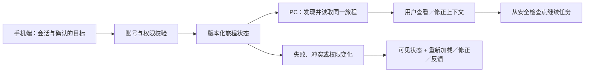

# 点点跨设备用户旅程连续性｜概念方案 v0.1

更新：2026-11-03。状态：**基于限定条件实测的概念提案**。适用范围：小红书 App 内置点点 ↔ 点点 PC Web。本方案不描述或推断点点现有内部架构；现状证据见 [Evidence Ledger](../research/evidence-ledger.md)，可选补测步骤见 [测试协议](../research/test-protocol.md)。

## 一句话判断

用户在手机上捕捉灵感，转到电脑完成整理和创作时，应能继续**同一个目标**。会话列表出现只是第一步；来源引用、已确认约束、未完成任务和用户控制权也要接得上。

本方案要减少重新寻找、重新解释和重复执行的成本，让注意力回到内容本身。这是「好的设计，是熵减与解放」在这一旅程中的具体含义。

**实施优先级：先做 P0 同一会话双向可见并继续。** Context 与 Execution 是后续扩展，不能让三层架构讨论拖慢眼前的 History 问题。当前可用的[手动交接办法](../HANDOFF-NOW.md)供妳临时继续任务。

## 问题、对象与证据边界

- **目标人群：** 在小红书浏览笔记时形成研究或创作任务，稍后在电脑上深入处理的用户。
- **核心场景：** 手机内置点点讨论周末城市漫游路线，引用站内笔记并确定「不要排满、保留写稿时间」；电脑打开同一任务，比较路线并写稿。
- **已知观察：** 妳用同一小红书账号，在所称最新版 iOS App 与当前 PC Web 各新建会话一次，两个方向均未在对端看到；数字版本、等待时长、刷新结果和截图未记录。这是限定条件下的 User-tested 结果，不能泛化为所有用户或判定后台根因 [E-011/E-012](../research/evidence-ledger.md)。
- **行业参照：** 官方文档中有跨平台 History 的先例；云端 Agent 任务接力也有条件明确的先例。它们证明方案方向可讨论，不证明点点已经或必然采用相同实现 [Benchmark](../research/benchmark.md)。

## 北极星旅程

| 时刻 | 用户动作 | 系统应提供 | 失败时的可见反馈 |
| --- | --- | --- | --- |
| Capture / 手机 | 开始对话、引用笔记、确认目标与约束 | 生成可定位的同一会话；来源可回溯；显式保存用户确认的目标 | 清楚说明哪些内容尚未保存或无法跨端使用 |
| Switch / 换端 | 登录同一账号，在电脑查看最近任务 | 目标会话可发现；展示同步状态与最后更新时间 | 区分账号不符、尚在同步、权限变化和未知错误；允许刷新与反馈 |
| Continue / 电脑 | 打开会话并追问路线取舍 | 恢复历史、来源、目标、约束和可继续的任务检查点 | 显示缺失层级；不假装已经理解；允许用户补全或修正 |
| Create / 电脑 | 对比、改稿、导出成果 | 延续同一目标，用户可审阅和编辑 Agent 理解 | 对高风险/外部动作另行确认，失败后能回到安全检查点 |

## 三层状态与最小数据契约

| 层 | 最小可恢复内容 | 用户可见能力 | 不满足时 |
| --- | --- | --- | --- |
| History | 稳定会话 ID、消息 ID/顺序、发送端与时间、笔记引用 ID/可用性、删除或隐藏状态 | 在另一端找到同一会话和原始引用 | 不把空白会话包装成成功同步；说明历史缺失 |
| Agent Context | 当前目标、用户明确约束、已采用来源、待办、摘要版本及确认人/时间 | 查看、修正、撤销 Agent 的理解 | 展示「需要重新确认」，不静默编造背景 |
| Execution State | 任务 ID、阶段、已完成步骤、结果引用、待确认动作、失败码、可重试检查点 | 暂停、继续、重试、查看哪些步骤已经完成 | 不重复执行已有外部副作用；说明无法恢复的步骤 |

**建议的数据关系（架构提案，非现状）：** 一个 `account_id` 可拥有多个 `journey_id`；一个 journey 关联一个或多个 `conversation_id`、来源引用和任务。每层独立记录 `updated_at`、`version`、`sync_status` 与权限范围。客户端根据版本做增量读取，冲突时保留双方修改并让用户选择，不能用最后写入覆盖已确认约束。删除与撤销应跨端传播。

## 关键功能与验收条件

### P0｜同一会话接力

1. 手机创建新会话并发送两条消息，电脑同账号可定位到同一 ID；刷新后保持可见。电脑回一条消息，手机可看到相同顺序。测试对应 T01、T02、T04、T05。
2. 旧会话按迁移范围明确说明；若旧数据不在覆盖范围，界面显式告知，不能让用户误认为内容丢失。测试对应 T03。
3. 笔记引用保留原始 ID、标题/摘要、访问权限状态；目标端权限失效时保留可理解的占位与说明，不偷偷替换引用。测试对应 T06。
4. 账号不符、同步进行中、同步失败分别显示可操作状态；每个状态有下一步。重新登录后可恢复已承诺保存的历史。测试对应 T08。

**P0 最小实施切片（建议，不代表点点现有架构）：**

| 环节 | 必须交付 | 可验收结果 |
| --- | --- | --- |
| 保存 | 新会话与消息在服务端确认后获得稳定 `conversation_id`、`message_id` 和顺序号；客户端发送时带去重键 | 网络重试不产生重复消息，界面不把仅保存在本机的内容称为「已同步」 |
| 发现与读取 | 同一账号在手机和 PC 查询同一会话列表，并按会话 ID 读取有序消息与可用的笔记引用 | T01/T02 两方向的新会话均可定位；T04 刷新后仍可读取；T05 新消息顺序一致 |
| 失败反馈 | 客户端区分「等待保存」「等待另一端更新」「权限不可用」「读取失败」，给出刷新或重试入口 | 用户能看见最后确认的状态；失败时不展示空白页冒充成功 |
| 范围声明 | 明确旧会话是否迁移、哪些引用可跨端访问；删除和隐藏状态按相同权限规则传播 | T03/T06/T08 的结果与产品说明一致，不承诺尚未覆盖的数据 |

身份由登录态在服务端校验，不由客户端传入的账号 ID 决定授权。具体存储服务与接口路径由官方工程决定；这里限定需要保持的行为和数据不变量。

### P1｜上下文连续性

1. 同一会话换端后能准确复述用户**确认过的**目标与约束，并指出来源；未确认推断要单独标识。
2. 用户能查看、编辑、撤销目标和约束；修改后两端显示同一版本。相互冲突时不静默合并。
3. T07 的评估需以 History 可访问为前置条件；若 T01 失败，记为 `Blocked by History Unavailable`，不可直接判定 Context 功能失败。

### P2｜任务状态接力

1. 可区分 `queued / running / waiting_for_user / paused / failed / completed`；换端后展示真实状态与最近检查点。
2. 已完成步骤恢复时不重新运行；工具调用、发布或修改外部数据前仍需原本的授权和权限检查。
3. 任务失败时保留已完成结果和可重试范围；用户能取消或改目标。设备离线或本地文件不可用时说明恢复条件。

P0 是价值验证入口；P1/P2 的上线顺序取决于用户需求和技术可行性。当前 H5 用本地状态模拟三层，不表示这些验收条件已在点点产品实现。

## 同步与恢复的建议流程

这是目标架构示意。是否集中存储、如何迁移现有会话、消息是否端到端加密、引用权限如何校验，都需要官方工程与法务判断；本项目没有这些内部信息。

## 用户控制、隐私与风险

- 只同步用户有权访问的会话和引用；最小化共享内容，敏感消息可由用户选择不进入跨端摘要。
- 显示保存范围、来源与最后同步时间；让用户删除/导出自己的状态，并让删除跨端生效。
- 「Agent 记住了」必须能解释它记住什么、来自哪里、何时确认，且能纠错。
- 若后续证实跨端推荐提问使用了用户在另一端的行为信号，界面应让用户知道推荐依据并能关闭这类个性化。当前 [T09](../research/test-protocol.md) 只是待验证线索，不能写成点点现有机制。
- 部分内容恢复、旧数据未迁移、账号映射错误、权限失效、并发冲突、离线状态和重复执行是主要失败路径。不要把展示成功当作状态真实一致。
- 外部执行动作的授权不随设备切换自动扩大。检查点恢复也必须遵守原权限与用户确认。

## 双重价值指标与评估设计

| 指标 | 口径 | 用途 |
| --- | --- | --- |
| 跨端接力成功率 | 找到目标会话，并完成一次有效继续的次数 / 有意换端尝试次数 | P0 主指标 |
| 上下文恢复率 | 目标与关键约束被准确保留的接力次数 / 可评估接力次数 | P1 质量 |
| 恢复工作耗时 | 从目标端进入到完成第一步有效继续的时间；报告中位数与分布 | 用户省力 |
| 重复输入率 | 用户为恢复已说过内容而重述的次数 / 可评估接力次数 | 熵减反指标 |
| 用户控制感 | 体验后对「能看懂并修正 Agent 的理解」的问卷正向率，附样本量 | 解放感 |
| 跨端功能采用率 | 实际完成过一次接力的用户 / 有跨端使用条件的用户 | 业务价值 |

需同时看隐私投诉、错误引用、重复执行和任务放弃率等 guardrail。H5 中两组数值全是 [Demo Data](../app/)，不能作为点点或竞品实测。

## 分阶段验证

1. **研究基线：** T01/T02 已有同账号双向新会话不可见的限定结果。若刷新或旧会话结果会改变问题描述，再补对应步骤；公开表述保持「妳这次的体验」，不宣称普遍故障或内部根因。
2. **P0 概念测试：** 用 H5 观察用户能否找到并继续同一任务，记录理解偏差与时间。
3. **P0 工程试点建议：** 小范围同账号新会话双向读取，明确旧会话迁移范围和失败状态。此处是向产品团队提出的路线，并非本项目接入点点服务。
4. **P1/P2 扩展建议：** 先加入可审阅 Context，再对可安全恢复的任务引入 Execution checkpoint；分别评估收益与风险。

## 当前开放问题

- PC Web 与内置端是否已存在官方承诺的历史互通？具体账号、版本、区域与旧数据范围是什么？
- 笔记引用在另一端的权限和呈现如何变化？
- 用户更愿意自动恢复目标，还是先确认一张可编辑的 Context 卡片？
- 哪类任务值得跨端恢复执行，哪些只需要恢复历史和上下文？

以上问题按 [测试协议](../research/test-protocol.md) 与后续用户研究更新；不以黑盒现象直接宣称数据库或 API 根因。
